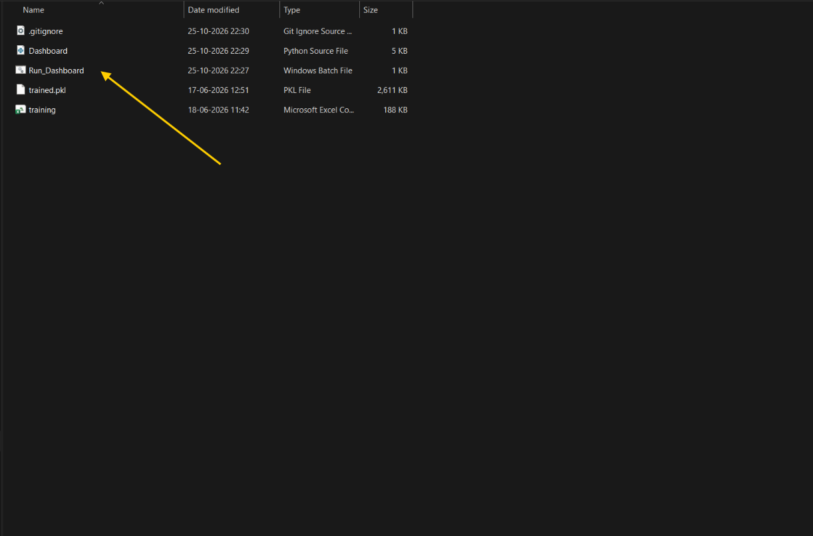
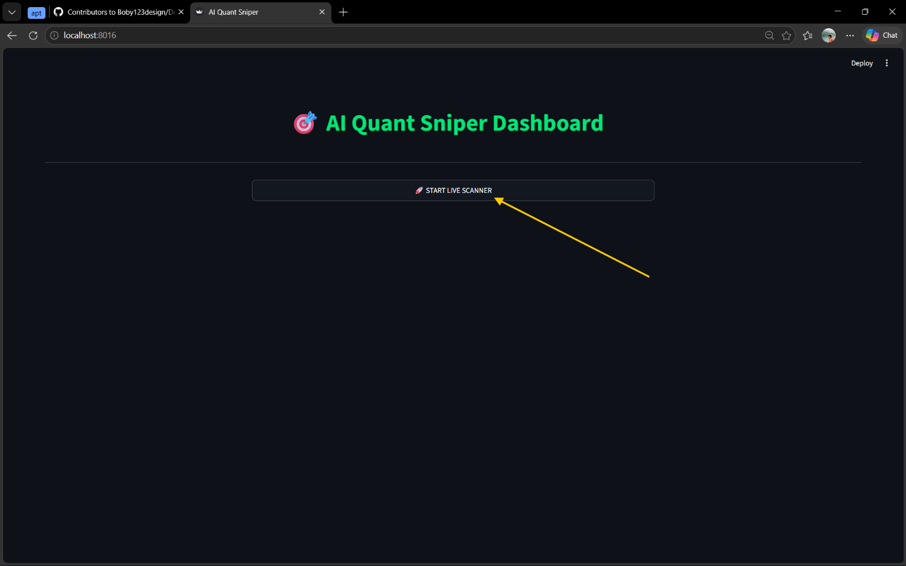
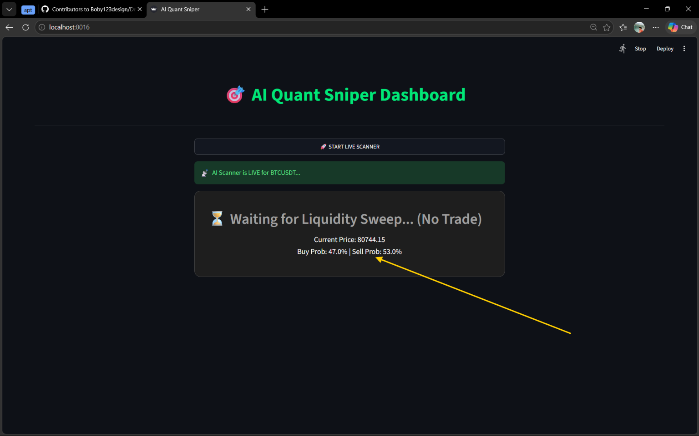
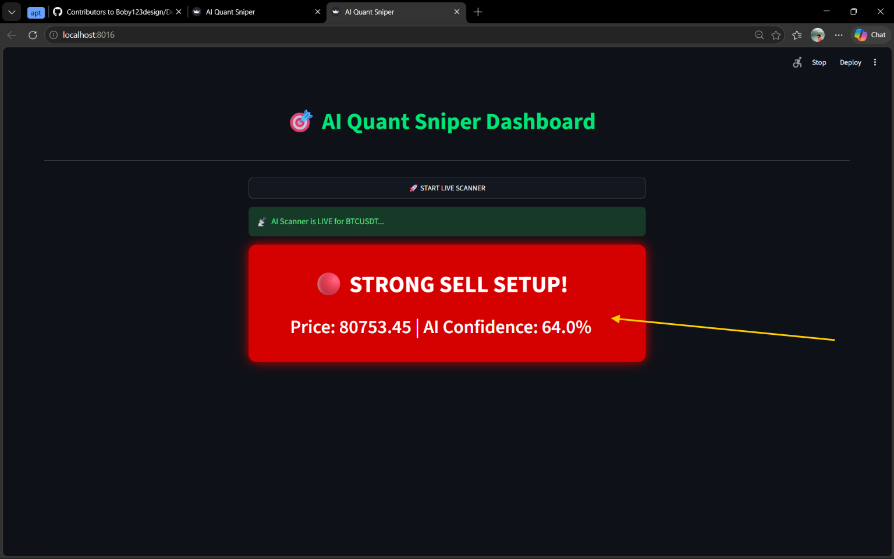

<div align="center">

# 🎯 AI Quant Sniper
### Machine-Learning-Powered Market Signal Dashboard

**Scan · Evaluate · Decide · Manage Risk**

A Python and Streamlit application that connects to MetaTrader 5, monitors BTCUSDT market data, and displays model-generated BUY/SELL signals when the configured confidence threshold is reached.

</div>

---

> [!IMPORTANT]
> **This is a decision-support prototype, not a guarantee of profitable trades.** Signals must be reviewed manually. Do not assume the app automatically executes trades, validates every liquidity sweep, or enforces account risk limits unless those capabilities are implemented and tested. Start with a demo account.

## 📚 Contents

- [Overview](#-overview)
- [How It Works](#-how-it-works)
- [Dashboard Preview](#-dashboard-preview)
- [Features](#-features)
- [Technology Stack](#-technology-stack)
- [Project Structure](#-project-structure)
- [Installation](#-installation)
- [Launch the Dashboard](#-launch-the-dashboard)
- [Signal and Risk Checklist](#-signal-and-risk-checklist)
- [Model and Dataset Compatibility](#-model-and-dataset-compatibility)
- [Troubleshooting](#-troubleshooting)
- [Limitations](#-limitations)
- [Risk Disclaimer](#-risk-disclaimer)

## 🚀 Overview

AI Quant Sniper provides a simple dashboard for monitoring a machine-learning market signal. The intended workflow is to launch the app, start the live scanner, wait for a potential liquidity-sweep setup, review the signal and confidence, and make an independent, risk-aware entry decision.

### Intended workflow

1. Launch the app with `Run_Dashboard.bat`.
2. Open the local dashboard and click **START LIVE SCANNER**.
3. Let the scanner monitor the configured market data.
4. Wait for a potential qualifying liquidity-sweep setup.
5. Review the BUY/SELL alert and model confidence.
6. Decide manually whether the setup meets your trading plan.
7. If entering, apply your own position sizing, stop-loss, take-profit, and daily loss rules.

## 🔄 How It Works

```text
Run_Dashboard.bat
        |
        v
Start Streamlit Dashboard
        |
        v
Connect to MetaTrader 5
        |
        v
Read recent BTCUSDT M1 candles
        |
        v
Prepare model input features
        |
        v
Run trained model and read probabilities
        |
        v
Check configured confidence condition
        |
   +----+-----+
   |          |
 No signal  Threshold met
   |          |
   v          v
Wait /     Display BUY or SELL
No Trade   alert and confidence
              |
              v
      User reviews setup + risk
              |
              v
       Manual entry decision
```

**Liquidity-sweep implementation note:** The intended strategy waits for a good-quality liquidity sweep. Verify in `Dashboard.py` that real sweep-detection logic is implemented and gates the model alert. A “Waiting for Liquidity Sweep” message alone does not prove that the condition is actually being checked.

## 🖥️ Dashboard Preview

The screenshots below document the project files, initial dashboard, scanner waiting state, and an example alert. Keep the images in the `screenshots/` folder with the exact filenames shown.

### 1. Project files and launcher



### 2. Dashboard before scanning



Click **🚀 START LIVE SCANNER** to start the scanner.

### 3. Scanner waiting for a setup



The dashboard may display the current price and BUY/SELL probabilities while waiting for a qualifying signal.

### 4. Example confidence alert



This example shows **STRONG SELL SETUP** with **64.0% AI confidence**. It demonstrates the interface only; it does not establish that the trade was profitable or that the confidence is calibrated.

## ✨ Features

- Streamlit dashboard for local market monitoring.
- MetaTrader 5 integration for recent candle data.
- BTCUSDT one-minute (M1) scanning by default, subject to broker symbol availability.
- Model inference using `trained.pkl`.
- BUY/SELL probability display and configured confidence alert.
- Waiting/no-trade state when the signal condition is not met.
- Windows sound alerts using `winsound` (Windows only).
- Windows batch launcher for simplified startup.

## 🧰 Technology Stack

| Component | Technology |
|---|---|
| Dashboard | Streamlit |
| Programming language | Python |
| Market data | MetaTrader 5 Python package |
| Data handling | Pandas, NumPy |
| Model loading | Joblib / serialized estimator |
| Model framework | Depends on how `trained.pkl` was trained |
| Sound alerts | `winsound` on Windows |

## 📁 Project Structure

```text
Model_16/
├── Dashboard.py
├── Run_Dashboard.bat
├── trained.pkl
├── training.csv
├── .gitignore
├── README.md
├── Working.md
└── screenshots/
    ├── 01-launch-files.png
    ├── 02-dashboard-start.png
    ├── 03-scanner-waiting.png
    └── 04-strong-sell-alert.png
```

| File | Purpose |
|---|---|
| `Dashboard.py` | Dashboard UI, market data, feature preparation, model inference |
| `Run_Dashboard.bat` | Windows launcher |
| `trained.pkl` | Serialized model required at runtime |
| `training.csv` | Training/reference dataset |
| `Working.md` | Step-by-step workflow |
| `screenshots/` | Images used in this README |

Windows File Explorer may hide extensions. For example, `Dashboard` may be `Dashboard.py` and `training` may be `training.csv`.

## 💻 Requirements

- Windows recommended for the current sound-alert implementation.
- Python compatible with the installed dependencies and saved model.
- MetaTrader 5 desktop terminal installed, open, and logged in.
- A broker/demo account that provides the configured instrument.
- The `trained.pkl` file at the path expected by the dashboard.
- The screenshot files in the `screenshots/` folder for GitHub previews.

## ⚙️ Installation

### 1. Open the project folder

Open PowerShell in the folder containing `Dashboard.py` and `Run_Dashboard.bat`.

### 2. Create a virtual environment

```powershell
py -m venv .venv
.\.venv\Scripts\Activate.ps1
```

### 3. Install dependencies

```powershell
python -m pip install --upgrade pip
pip install streamlit MetaTrader5 pandas numpy joblib scikit-learn
```

The exact dependencies depend on the model saved in `trained.pkl`. Install any additional packages required by its training environment.

### 4. Prepare MetaTrader 5

1. Open MetaTrader 5 and log in.
2. Confirm the terminal is connected to the broker.
3. Find the desired instrument in Market Watch.
4. Confirm the exact broker-specific symbol name.
5. Use a demo account for initial testing.

The dashboard is configured for `BTCUSDT` by default. Brokers may use a different name or suffix; update the symbol in `Dashboard.py` if needed.

### 5. Check the model file

Confirm `trained.pkl` is available at the expected path. **Only load pickle/joblib files from sources you trust**, because serialized Python objects can execute code during loading.

## ▶️ Launch the Dashboard

### Option A — Windows launcher

Double-click `Run_Dashboard.bat`. Keep its terminal window open while using the dashboard. The current launcher uses port **8016**.

### Option B — PowerShell

```powershell
python -m streamlit run Dashboard.py --server.port 8016
```

Open the local address printed by Streamlit, typically `http://localhost:8016`.

### Start scanning

1. Ensure MT5 is connected and the symbol is available.
2. Open the dashboard in your browser.
3. Click **START LIVE SCANNER**.
4. Monitor status, price, probabilities, and any alert.
5. Review the setup independently before considering an entry.

## 🛡️ Signal and Risk Checklist

Before a manual entry, verify:

- [ ] The liquidity-sweep condition and confirmation rules are genuinely satisfied.
- [ ] BUY/SELL direction matches the planned setup.
- [ ] The alert remains valid at the current market price.
- [ ] Stop-loss placement is defined before entry.
- [ ] Position size is calculated from account risk and stop-loss distance.
- [ ] Spread, commission, slippage, and volatility are considered.
- [ ] Daily drawdown and consecutive-loss rules are respected.
- [ ] The potential loss is acceptable.

**Do not assume this dashboard automatically calculates lot size, places broker-side SL/TP, blocks trades at a daily loss limit, or executes orders.** These are separate capabilities and must be implemented and tested explicitly.

## 🧪 Model and Dataset Compatibility

The `training.csv` file has been described as containing:

```text
Time, Trade_Type, RSI_14, Volume, Risk_Points, Outcome
```

The live inference path has been described as sending:

```text
volume, RSI_14, Candle_Size, Body_Size, Wick_Top, Wick_Bottom
```

These feature schemas differ. Before relying on predictions, verify:

1. The exact feature definitions used in training.
2. The number and order of model input features.
3. Training-time preprocessing, scaling, encoding, and missing-value handling.
4. That live inference applies the same preprocessing in the same order.
5. The saved model's actual class order; do not assume `0 = SELL` and `1 = BUY`.
6. Chronological out-of-sample performance with realistic spreads, commissions, and slippage.

Do not retrain using `training.csv` until the target column and valid input features have been confirmed. Model confidence is not automatically a calibrated probability of winning.

## 🧯 Troubleshooting

**Dashboard does not open**
- Read the terminal error output.
- Confirm packages are installed in the same Python environment used to launch Streamlit.
- Check whether port `8016` is already in use.
- Try the manual launch command above.

**MT5 connection fails**
- Open MT5 and log in.
- Check broker connectivity.
- Confirm `MetaTrader5` is installed in the correct Python environment.
- Restart MT5 and the dashboard if needed.

**No symbol or candle data**
- Check the instrument in Market Watch.
- Update `BTCUSDT` to the exact broker symbol.
- Confirm M1 history is available.

**Scanner keeps waiting**
- No setup may currently meet the configured conditions.
- Check terminal logs for data/inference errors.
- Verify liquidity-sweep detection and confidence filtering in the source code.

**Model loading or prediction errors**
- Confirm `trained.pkl` exists at the expected path.
- Check Python and library-version compatibility.
- Verify feature order, preprocessing, and class mapping.
- Never load an untrusted serialized model.

**Sound alerts do not play**
- `winsound` is Windows-specific.
- Check system volume and Windows sound settings.

## 🚧 Limitations

- The symbol and confidence threshold may be hard-coded rather than adjustable in the UI.
- Broker symbol naming and data availability can vary.
- Actual liquidity-sweep gating must be verified in code.
- The CSV and live feature schemas need compatibility checks.
- Model class order must be confirmed.
- The dashboard is not, by itself, an automated execution or complete risk-management system.
- Depending on the implementation, stopping a continuous scanner may require stopping the Streamlit process.

## ⚠️ Risk Disclaimer

This project is intended for research and educational purposes. Cryptocurrency and other financial markets are volatile, and trading can cause substantial losses. Machine-learning models can be wrong, poorly calibrated, or fail when market conditions change. Confidence scores do not guarantee future results.

Test with a demo account. Validate the model using chronological out-of-sample data, realistic transaction costs, and robust risk controls before considering live trading. You are responsible for all trading decisions.

---

<div align="center">

**AI Quant Sniper** · Machine Learning × Market Monitoring × Human Risk Control

</div>
